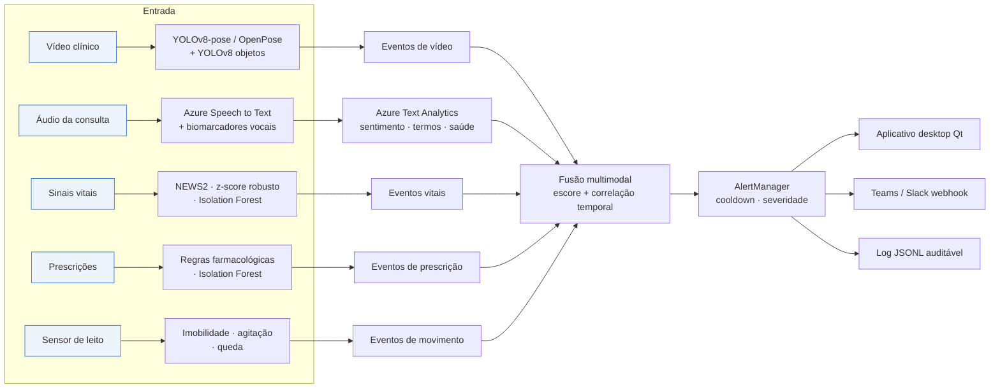
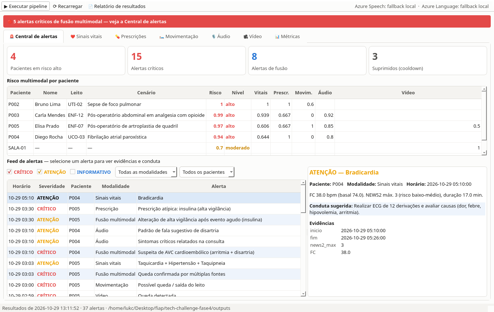

# MedMonitor — Monitoramento Multimodal de Pacientes

**Tech Challenge — Fase 4 · Pós-Tech IA para Devs (FIAP)**

Sistema que monitora pacientes continuamente a partir de **vídeo, áudio, texto e séries temporais**, detecta sinais precoces de risco e envia **alertas priorizados à equipe médica**. Os serviços gerenciados do **Azure AI (Cognitive Services)** são usados para transcrição e análise de texto.

| Requisito do desafio | Onde está |
|---|---|
| Análise de vídeo com **OpenPose** e **YOLOv8** | [`src/medmonitor/video/`](src/medmonitor/video/) — YOLOv8-pose (padrão) e OpenPose (OpenCV DNN), YOLOv8 para objetos e áreas críticas, relatório automático por vídeo |
| Áudio com **Azure Speech to Text** e **Azure Text Analytics** | [`src/medmonitor/audio/`](src/medmonitor/audio/) — transcrição contínua com timestamps por palavra, sentimento com mineração de opinião, frases-chave, Text Analytics for Health e biomarcadores vocais (fadiga, dispneia, disartria) |
| Anomalias em **sinais vitais, prescrições e movimentação** | [`src/medmonitor/anomaly/`](src/medmonitor/anomaly/) — NEWS2 + z-score robusto + Isolation Forest, monitor em tempo real; regras farmacológicas + Isolation Forest; imobilidade, agitação noturna e queda |
| Fusão multimodal e alertas | [`fusion.py`](src/medmonitor/fusion.py), [`alerts.py`](src/medmonitor/alerts.py) — 7 regras de correlação entre modalidades, escore de risco, cooldown, webhook (Teams/Slack) |
| Interface da equipe médica | [`gui/`](src/medmonitor/gui/) — aplicativo desktop nativo (Qt/PySide6), sem navegador |
| Relatório técnico | [`docs/RELATORIO_TECNICO.md`](docs/RELATORIO_TECNICO.md) |
| Notebook (Google Colab / VS Code) | [`colab/MedMonitor_Colab.ipynb`](colab/MedMonitor_Colab.ipynb) — execução passo a passo de todas as modalidades ([instruções](colab/README.md)) |
| Roteiro do vídeo de 15 min | [`docs/ROTEIRO_VIDEO.md`](docs/ROTEIRO_VIDEO.md) |



## Início rápido

```bash
python3 -m venv .venv && source .venv/bin/activate
pip install torch torchvision --index-url https://download.pytorch.org/whl/cpu   # CPU (opcional: versão CUDA)
pip install -r requirements.txt

python main.py demo                 # fluxo completo: gera/baixa dados, processa as 5 modalidades, funde e alerta
python main.py gui                  # aplicativo desktop da equipe médica
```

Na primeira execução o `demo` gera os dados sintéticos, sintetiza os áudios de consulta (gTTS ou Azure TTS), baixa os vídeos públicos e os pesos YOLOv8 (~13 MB). Leva ~2 min em CPU; as execuções seguintes reaproveitam o processamento de vídeo (~15 s).

### Ativando o Azure

Sem credenciais, o sistema roda inteiro em **modo local** (transcrição de referência + léxico em português) e indica isso em cada resultado. Para usar os serviços Azure:

```bash
az login
bash infra/azure_setup.sh            # cria Speech + Language (camada F0) e grava as chaves no .env
python main.py azure-check           # TTS → Speech to Text → Text Analytics com uma frase de teste
python main.py demo
```

Ou copie `.env.example` para `.env` e preencha `AZURE_SPEECH_KEY`, `AZURE_SPEECH_REGION`, `AZURE_LANGUAGE_KEY`, `AZURE_LANGUAGE_ENDPOINT`. Para receber os alertas no Microsoft Teams, defina `ALERT_WEBHOOK_URL` com a URL de um fluxo *Workflows* ("Post to a channel when a webhook request is received") — os alertas chegam como Adaptive Cards.

## Comandos

| Comando | O que faz |
|---|---|
| `python main.py demo [--no-video] [--reprocess-video] [--regenerate]` | Pipeline multimodal completo + `outputs/relatorio_resultados.md` |
| `python main.py gui` | **Aplicativo desktop** (Qt): central de alertas, vitais com monitor em tempo real, prescrições, movimentação, áudio e vídeo com players, métricas |
| `python main.py stream --patient P003 --from-hour 13` | Replay em tempo real dos sinais vitais no terminal, com alertas surgindo ao vivo |
| `python main.py audio <arquivo> --patient P003` | Analisa um áudio (wav/mp3/m4a/ogg) |
| `python main.py video <arquivo> --profile agachamento` | Analisa um vídeo; gera vídeo anotado, gráfico e relatório |
| `python main.py video <arquivo> --openpose` | Mesmo, com o backend OpenPose (requer pesos, ver abaixo) |
| `python main.py video <arquivo> --zones` | Ativa o monitoramento das áreas críticas definidas no `config.yaml` |
| `python main.py physionet --record 14` | Detecção em sinais vitais **reais** (PhysioNet BIDMC) |
| `python main.py azure-check` | Valida as credenciais Azure |
| `pytest` | 28 testes automatizados |

Perfis de exercício disponíveis: `agachamento`, `sentar_levantar`, `elevacao_braco`, `flexao_cotovelo` (configuráveis no `config.yaml`).

### Backend OpenPose (opcional)

O padrão é o YOLOv8-pose (mais rápido e preciso em CPU). Para usar o OpenPose da CMU via OpenCV DNN:

```bash
mkdir -p models/openpose
curl -L -o models/openpose/pose_deploy_linevec.prototxt \
  https://raw.githubusercontent.com/CMU-Perceptual-Computing-Lab/openpose/master/models/pose/coco/pose_deploy_linevec.prototxt
curl -L -o models/openpose/pose_iter_440000.caffemodel \
  https://huggingface.co/camenduru/openpose/resolve/main/models/pose/coco/pose_iter_440000.caffemodel   # espelho (200 MB)
```

Requer OpenCV 4.x (a série 5 removeu o importador Caffe) — já fixado no `requirements.txt`.

### Aplicativo desktop



Abas: **Central de alertas** (KPIs, risco por paciente, feed filtrável com evidências e conduta) · **Sinais vitais** (histórico de 24 h e monitor em tempo real com faixa vermelha e notificação do sistema para alertas críticos) · **Prescrições** · **Movimentação** · **Áudio** (ouvir a consulta, indicadores vocais, transcrição, sentimento e termos críticos; abrir novos arquivos) · **Vídeo** (player do vídeo anotado, gráfico de ângulos, repetições; abrir novos vídeos com perfil, pessoa, áreas críticas e OpenPose) · **Métricas**. Processamentos longos rodam em segundo plano, sem travar a janela.

## Estrutura

```
├── main.py                    CLI
├── config.yaml                limiares clínicos e técnicos (tudo configurável)
├── src/medmonitor/
│   ├── video/                 pose.py (YOLOv8-pose, OpenPose, cinemática) · objects.py (YOLOv8, zonas) · analyzer.py
│   ├── audio/                 features.py (biomarcadores) · azure_speech.py · azure_text.py · analyzer.py
│   ├── anomaly/               vitals.py · prescriptions.py · movement.py · utils.py
│   ├── data/                  synthetic.py · demo_audio.py · demo_video.py · physionet.py
│   ├── gui/                   aplicativo desktop (PySide6): app.py · widgets.py
│   ├── fusion.py              escore de risco + regras de correlação temporal
│   ├── alerts.py              modelo de alerta, cooldown, console/JSONL/webhook
│   ├── pipeline.py            orquestração + avaliação contra ground truth
│   └── report.py              figuras e relatório de resultados
├── colab/                     notebook para Google Colab / VS Code + empacotador
├── tests/                     pytest
├── infra/azure_setup.sh       provisionamento Azure (az CLI)
├── docs/                      relatório técnico, roteiro do vídeo, figuras
└── data/                      dados sintéticos, áudios e vídeos de demonstração
```

## Dados e licenças

- **Pacientes**: sintéticos, gerados por [`synthetic.py`](src/medmonitor/data/synthetic.py) com anomalias rotuladas (ground truth). Nenhum dado real de paciente identificável é usado.
- **Sinais vitais reais**: [BIDMC PPG and Respiration Dataset](https://physionet.org/content/bidmc/1.0.0/) (PhysioNet, ODC-BY 1.0).
- **Vídeos**: *30-Second Chair Stand Test* (CDC STEADI, domínio público); *Squat and Frontal Raise* (Taco fleur, CC BY-SA 4.0) — a queda é uma **simulação sintética** derivada deste; *solutions_ci_demo* (Ultralytics assets, AGPL-3.0).
- **Áudios**: fala sintetizada (gTTS/Azure TTS) com efeitos de sinal que simulam fadiga, dispneia e disartria.

> ⚠️ Projeto acadêmico. Ferramenta de **apoio** à decisão — não é dispositivo médico e não substitui avaliação profissional.
