# Relatório Técnico — MedMonitor

**Tech Challenge · Fase 4 · Pós-Tech IA para Devs (FIAP)**
Monitoramento contínuo de pacientes por análise e fusão de dados multimodais (vídeo, áudio, texto e séries temporais) com serviços gerenciados Azure AI.

---

## Sumário

1. [Objetivo e escopo](#1-objetivo-e-escopo)
2. [Fluxo multimodal](#2-fluxo-multimodal)
3. [Dados utilizados](#3-dados-utilizados)
4. [Modelos aplicados em cada tipo de dado](#4-modelos-aplicados-em-cada-tipo-de-dado)
5. [Fusão multimodal e alertas](#5-fusão-multimodal-e-alertas)
6. [Resultados obtidos](#6-resultados-obtidos)
7. [Exemplos de anomalias detectadas](#7-exemplos-de-anomalias-detectadas)
8. [Limitações e considerações éticas](#8-limitações-e-considerações-éticas)
9. [Próximos passos](#9-próximos-passos)
10. [Reprodutibilidade](#10-reprodutibilidade)
11. [Referências](#11-referências)

---

## 1. Objetivo e escopo

O hospital já usa IA para analisar exames e documentos. O objetivo desta fase é **monitorar continuamente** os pacientes e **identificar sinais precoces de risco** cruzando fontes de natureza diferente. O MedMonitor:

- analisa **vídeos** de fisioterapia, mobilidade e áreas críticas (pose humana com OpenPose/YOLOv8-pose e objetos com YOLOv8), gerando relatórios automáticos de desvios;
- processa **áudios de consultas** com **Azure Speech to Text** e **Azure Text Analytics**, e extrai biomarcadores vocais de fadiga, dificuldade respiratória e disartria;
- detecta **anomalias** em séries temporais de **sinais vitais**, na **evolução das prescrições** e nos **padrões de movimentação** durante a internação;
- **funde** os achados por paciente, correlacionando eventos no tempo, e **alerta a equipe** com severidade, evidências e conduta sugerida.

A solução é um sistema de **apoio à decisão**: todo alerta aponta a evidência que o gerou e a decisão permanece com a equipe.

## 2. Fluxo multimodal

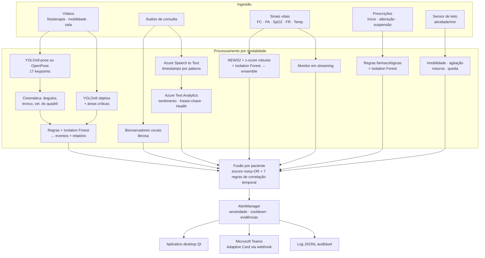

**Etapas:**

1. **Ingestão.** Cada fonte tem um formato tabular ou de arquivo simples (CSV de vitais/prescrições/movimento, WAV/MP3, MP4) e um manifesto que associa arquivo, paciente e horário.
2. **Processamento por modalidade.** Cada modalidade usa o modelo mais adequado ao seu tipo de dado (seção 4) e produz duas saídas padronizadas: uma lista de **alertas** (`Alert`: paciente, modalidade, severidade, título, descrição, horário do evento, evidências e conduta sugerida) e um **escore de risco 0–1**.
3. **Fusão (late fusion).** Os alertas de todas as modalidades de um paciente são cruzados em janelas de tempo por regras clínicas; os escores viram um risco único por paciente (seção 5).
4. **Despacho.** O `AlertManager` ordena por horário, suprime repetições (cooldown de 30 min por paciente/modalidade/título) e envia para console, log JSONL e webhook do Teams/Slack. O aplicativo desktop da equipe lê o mesmo log.

A escolha por **fusão tardia** (no nível de decisão) se justifica porque as modalidades têm frequências e naturezas muito diferentes (vitais por minuto, uma consulta gravada por turno, sessões de fisioterapia esporádicas): não há como alinhar vetores de features num mesmo instante, mas há como correlacionar **eventos** no tempo. Também deixa cada modalidade explicável isoladamente.

## 3. Dados utilizados

| Modalidade | Fonte | Observação |
|---|---|---|
| Sinais vitais | **Sintéticos** (5 pacientes × 24 h × 1/min) com anomalias rotuladas | Permitem medir precisão/recall contra um *ground truth* conhecido |
| Sinais vitais reais | **PhysioNet — BIDMC PPG and Respiration** (53 registros de UTI, 8 min, 1 Hz: FC, FR, SpO2) | Valida o detector em dados reais (seção 6.6) |
| Prescrições | Sintéticas (24 eventos, 7 anomalias rotuladas) | |
| Movimentação | Sintética (atividade por minuto no leito) com imobilidade, agitação e queda rotuladas | Equivalente a acelerômetro/sensor de pressão do colchão |
| Áudio | 4 consultas sintetizadas (gTTS ou Azure Neural TTS) + efeitos de sinal que simulam fadiga, dispneia e disartria; transcrição de referência ao lado | Não há base pública de consultas em português com rótulos clínicos |
| Vídeo | *30-Second Chair Stand Test* (CDC, domínio público); *Squat and Frontal Raise* (CC BY-SA 4.0); queda **simulada** por rotação sintética; *solutions_ci_demo* (Ultralytics) para área crítica | Fontes e licenças registradas no manifesto |

O AudioSet (sugerido no enunciado) contém rótulos de eventos sonoros como tosse e respiração, mas não consultas clínicas; por isso optou-se por áudios sintéticos com rótulos controlados para validar a cadeia completa (sinal → Azure → texto → alerta).

**Cenários clínicos sintéticos** — cada paciente exercita detectores e regras de fusão diferentes:

| Paciente | Cenário | O que deve ser detectado |
|---|---|---|
| P001 | Controle estável | Nada; contém um **artefato** de oxímetro (SpO2 = 62% por 1 min) que deve ser **filtrado** |
| P002 | Sepse de foco pulmonar | Febre + taquicardia + taquipneia + hipotensão; duplicidade de anticoagulante; agitação noturna (delirium) |
| P003 | Analgesia com opioide | Morfina aumentada 5× + midazolam → bradipneia e dessaturação 1 h depois; fala com dispneia |
| P004 | Fibrilação atrial paroxística | 3 episódios de taquicardia, bradicardia, KCl acima da dose máxima; fala disártrica |
| P005 | Pós-operatório de artroplastia (79 anos) | Atelectasia sutil, imobilidade de 5,5 h, queda às 03:00 com taquicardia de dor, insulina 3× de madrugada; fala com fadiga; teste funcional |

## 4. Modelos aplicados em cada tipo de dado

### 4.1 Vídeo

**Pose humana — dois backends com a mesma interface** ([`pose.py`](../src/medmonitor/video/pose.py)):

| | YOLOv8-pose (padrão) | OpenPose (CMU, COCO-18) |
|---|---|---|
| Execução | Ultralytics, PyTorch | OpenCV DNN (Caffe), pesos `pose_iter_440000` |
| Abordagem | *Top-down* de estágio único, multipessoa | Mapas de calor + *Part Affinity Fields* |
| Keypoints | COCO-17 | COCO-18 remapeados para COCO-17 (sem "pescoço") |
| Tempo em CPU (vídeo 640×480) | **≈1,1 s por segundo de vídeo** (pose + objetos) | ≈19 s por segundo de vídeo (só pose) |

Os dois backends foram executados no mesmo vídeo de agachamento e **concordam no que importa clinicamente**: as mesmas 3 repetições nos primeiros 12 s, com início e fim coincidentes em até 0,1 s, e o mesmo evento de compensação de tronco aos 9,4 s. O OpenPose estima o joelho menos flexionado (mínimo médio 69,7° vs 51,9° do YOLOv8, cuja estimativa visualmente acompanha melhor a imagem). Como o YOLOv8-pose é ~17× mais rápido, ele é o padrão e o OpenPose fica disponível pela opção `--openpose`.

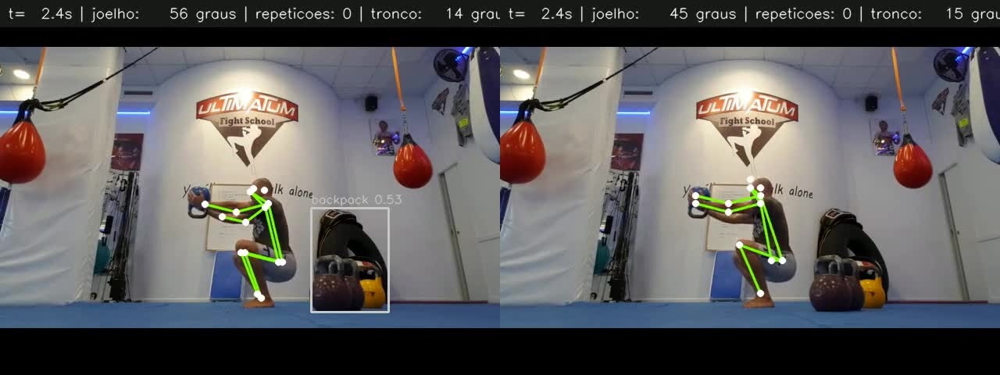

**Cinemática.** A partir dos keypoints calculam-se os ângulos de cotovelo, ombro, quadril e joelho (vértice no ponto central), a inclinação do tronco em relação à vertical e a velocidade vertical do quadril normalizada pela altura do corpo (corpos/s), suavizados por mediana móvel.

**Detecção de eventos** ([`analyzer.py`](../src/medmonitor/video/analyzer.py)):

| Evento | Método |
|---|---|
| Repetições, amplitude (ROM), cadência | Máquina de estados com histerese sobre o ângulo da articulação do perfil (estendido → flexionado → estendido) |
| Repetição incompleta | Descida que retorna à extensão sem atingir a flexão alvo |
| Hesitação | Repetição com duração > 2× a mediana |
| Fadiga | Inclinação negativa da ROM ao longo das repetições (queda > 25%) |
| Compensação de tronco | Inclinação acima do limite do perfil por ≥ 0,5 s |
| Assimetria | Diferença esquerda × direita > 30° com ambos os lados visíveis |
| **Queda** | Quadril desce > 1,2 corpos/s **e** o corpo fica horizontal (bbox largura/altura > 1 ou tronco > 60°) em até 1,5 s |
| Padrão atípico | Isolation Forest sobre ângulos + velocidades angulares |
| Teste de sentar e levantar 30 s | Repetições extrapoladas para 30 s comparadas à tabela CDC STEADI (com ≥ 3 repetições) |

**Objetos e áreas críticas (YOLOv8).** As áreas são polígonos normalizados com lotação máxima, definidos no `config.yaml` (ex.: campo estéril, área restrita). Por quadro, verifica-se pessoas na área (base do bounding box), **objetos proibidos** (celular, copo, garrafa) e a **contagem de instrumentos** no início e no fim da gravação (discrepância indica possível instrumento retido — item do protocolo de cirurgia segura). Os pesos COCO não têm classes de instrumental cirúrgico (usam-se *scissors*/*knife* como substitutos); o detector aceita pesos ajustados em bases como m2cai16-tool sem mudança de código.

**Saídas por vídeo:** vídeo anotado em H.264 (esqueleto, ângulos, contador, zonas e faixas de alerta), gráfico de ângulos com eventos, série temporal em CSV, `result.json` e relatório Markdown com repetições e desvios.

### 4.2 Áudio

**Azure AI Speech — Speech to Text** ([`azure_speech.py`](../src/medmonitor/audio/azure_speech.py)): reconhecimento **contínuo** (adequado a consultas longas) em `pt-BR`, formato *Detailed* com **timestamps por palavra**, que permitem medir palavras por minuto e pausas entre palavras a partir da própria transcrição.

**Azure AI Language — Text Analytics** ([`azure_text.py`](../src/medmonitor/audio/azure_text.py)):

- **Análise de sentimento com mineração de opinião** por frase (ex.: alvo "ar", avaliação "falta");
- **Extração de frases-chave**;
- **Text Analytics for Health**: entidades clínicas (sintomas, medicamentos, partes do corpo) com **detecção de negação** e normalização para vocabulários médicos.

Os **termos críticos** configurados (respiratórios, cardíacos, neurológicos, gerais e de dor) são sempre procurados na transcrição, ignorando acentos e com detecção de negação numa janela de 3 palavras ("**não** tenho falta de ar" não gera alerta). Sem credenciais Azure, a transcrição de referência e um léxico de sentimento em português substituem os serviços, e cada resultado registra a fonte usada (`azure-speech`/`sidecar`, `azure-language`/`local`).

**Biomarcadores vocais** ([`features.py`](../src/medmonitor/audio/features.py)) — extraídos do sinal com librosa:

| Grupo | Medidas | Indicador que alimenta |
|---|---|---|
| Ritmo | taxa de fala e de articulação (núcleos silábicos, de Jong & Wempe), pausas/min, duração média de pausa e de segmento de fonação | fadiga, dispneia, disartria |
| Fonte glótica | F0 (pYIN), variabilidade de F0 em semitons, jitter e shimmer aproximados, HNR aproximada | fadiga (monotonia), disartria |
| Energia | inclinação da intensidade ao longo da fala (dB/min) | fadiga |
| Respiração | **inspirações audíveis**: trechos não vozeados e energéticos ≥ 250 ms | dispneia |
| Tremor | **índice de tremor vocal**: fração da potência da curva de F0 na faixa de 3,5–7,5 Hz | disartria |

Cada medida é mapeada linearmente para 0–1 entre uma referência de fala típica e um valor claramente alterado; os três indicadores são médias ponderadas dessas componentes. Um indicador ≥ 0,5 gera alerta; ele vira **CRÍTICO** quando ≥ 0,75 **e** corroborado pelo relato do paciente na transcrição (ex.: padrão vocal de dispneia + "falta de ar").

### 4.3 Sinais vitais

Três detectores complementares ([`vitals.py`](../src/medmonitor/anomaly/vitals.py)):

1. **Regras clínicas — NEWS2** (Royal College of Physicians, 2017) por amostra, mais limites absolutos por sinal. Capta o que é clinicamente grave mesmo que seja "normal" para o paciente.
2. **z-score robusto** (mediana/MAD, com piso de escala por sinal) calculado de duas formas: contra a **janela móvel** dos últimos 60 min (mudanças abruptas) e contra a **linha de base do próprio paciente** nas primeiras 4 h (derivas lentas, como febre). Prevalece o maior |z|.
3. **Isolation Forest multivariado** treinado na linha de base do paciente com nível + variação de 5 min de cada sinal; capta combinações incomuns.

**Ensemble:** votação por maioria (2 de 3) + **persistência mínima de 3 amostras** + união de eventos a menos de 30 min. A persistência é o que elimina artefatos de sensor.

**Monitor em tempo real** (`StreamingVitalsMonitor`): versão incremental que recebe uma amostra por vez, mantém janelas e linha de base em memória e emite o alerta no instante em que a anomalia se confirma — é o componente que rodaria acoplado ao monitor multiparamétrico.

> O Azure AI Anomaly Detector foi considerado, mas o serviço foi descontinuado pela Microsoft em 1º de outubro de 2026; por isso a detecção em séries temporais é feita com scikit-learn, e o Azure é usado onde ele agrega mais (fala e linguagem).

### 4.4 Prescrições

Cada evento (início, alteração, suspensão) vira um vetor de features ([`prescriptions.py`](../src/medmonitor/anomaly/prescriptions.py)) — razão de dose diária frente à anterior, alterações em 24 h, horário noturno, medicamento de alta vigilância (lista ISMP), fração da dose máxima. Regras farmacológicas pontuam: dose acima do máximo de referência (+3), salto abrupto ≥ 2× ou ≤ ½ (+2 em alta vigilância), duplicidade terapêutica (+2 para anticoagulantes), interação medicamentosa (+1), excesso de alterações (+1). Um **Isolation Forest** dá o escore de atipicidade do evento frente ao padrão do serviço e sinaliza eventos de alta vigilância atípicos mesmo sem regra violada.

### 4.5 Movimentação

Sobre a série de atividade por minuto ([`movement.py`](../src/medmonitor/anomaly/movement.py)):

- **Imobilidade prolongada:** sem reposicionamento por > 150 min (risco de lesão por pressão);
- **Agitação noturna:** atividade suavizada com z robusto > 3 contra a linha de base **noturna do próprio paciente** por ≥ 30 min (sinal precoce de *delirium*);
- **Possível queda/saída do leito:** pico extremo (z > 8) seguido de ausência total de sinal por ≥ 10 min;
- **Escore horário de atipicidade** (Isolation Forest com features normalizadas por período dia/noite), exibido no aplicativo como apoio visual. Na avaliação, com apenas 24 horas por paciente, esse modelo marcava 1–2 horas normais por paciente; por isso ele **não dispara alertas**, decisão documentada no código.

## 5. Fusão multimodal e alertas

**Escore de risco do paciente** ([`fusion.py`](../src/medmonitor/fusion.py)) — *noisy-OR* ponderado:

$$\text{risco} = 1 - \prod_{m} \left(1 - w_m \cdot s_m\right)$$

onde $s_m \in [0,1]$ é o escore de cada modalidade e $w_m$ seu peso (vitais 1,0; áudio e vídeo 0,7; prescrição e movimento 0,6). Uma modalidade muito alterada basta para elevar o risco, e várias moderadas se acumulam. Se uma regra de correlação crítica for disparada, o risco é elevado a pelo menos 0,9. Faixas: alto ≥ 0,75; moderado ≥ 0,45.

**Regras de correlação temporal** — padrões que **nenhuma modalidade detecta sozinha**:

| # | Regra | Modalidades | Janela | Severidade |
|---|---|---|---|---|
| R1 | Opioide/benzodiazepínico alterado **antes** de bradipneia/dessaturação → depressão respiratória induzida | prescrição → vitais | 6 h | CRÍTICO |
| R2 | Fala com padrão de dispneia + dessaturação/taquipneia → insuficiência respiratória | áudio + vitais | 6 h | CRÍTICO |
| R3 | Febre + taquicardia/hipotensão/taquipneia + agitação → sepse com *delirium* (qSOFA aproximado) | vitais + movimento | 12 h | CRÍTICO |
| R4 | Arritmia + disartria → suspeita de AVC cardioembólico | vitais + áudio | 6 h | CRÍTICO |
| R5 | Queda vista por ≥ 2 fontes (ou queda + alteração vital em 1 h) | movimento + vídeo + vitais | 1 h | CRÍTICO |
| R6 | Desempenho motor ruim + imobilidade/fadiga → risco de queda | vídeo + movimento/áudio | — | ATENÇÃO |
| R7 | Medicamento de alta vigilância alterado até 2 h após evento crítico | qualquer → prescrição | 2 h | ATENÇÃO |

**Alertas** ([`alerts.py`](../src/medmonitor/alerts.py)): três níveis (INFORMATIVO, ATENÇÃO, CRÍTICO), sempre com **evidências** e **conduta sugerida**. O cooldown evita a fadiga de alarmes, problema reconhecido em UTIs. Os canais são console, log JSONL (auditoria) e webhook — no Microsoft Teams o alerta chega como Adaptive Card com cor por severidade e as evidências em tabela.

**Interface da equipe — aplicativo desktop** ([`gui/`](../src/medmonitor/gui/), Qt/PySide6). Sem navegador nem servidor: abas de central de alertas, sinais vitais (histórico e monitor em tempo real), prescrições, movimentação, áudio, vídeo e métricas. No monitor em tempo real, cada alerta crítico gera uma faixa vermelha na janela, um aviso sonoro e uma notificação do sistema operacional. Análises de novos áudios e vídeos rodam em segundo plano (`QThreadPool`).

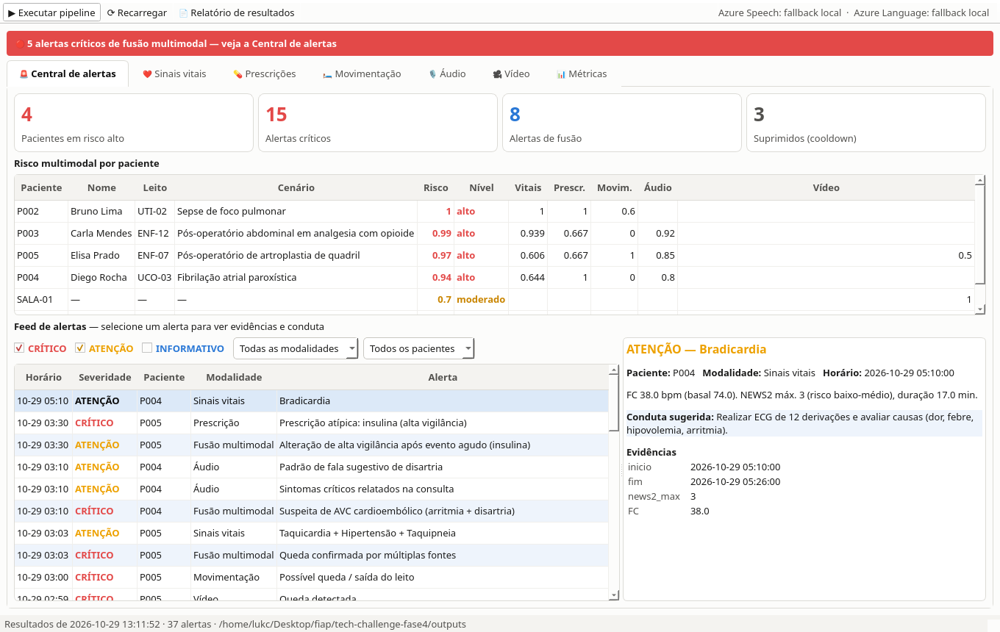

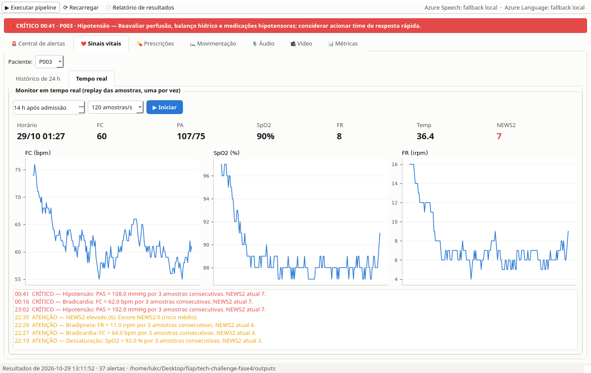

## 6. Resultados obtidos

Execução de `python main.py demo` (CPU, sem GPU). Os números abaixo estão em `outputs/results.json` e `outputs/relatorio_resultados.md`.

### 6.1 Sinais vitais — comparação de detectores (avaliação por evento, 8 eventos reais em 5 pacientes)

| Método | Recall | Precisão | F1 | Amostras falso-positivas |
|---|---|---|---|---|
| Regras clínicas (NEWS2 + limites) | 0,875 | 0,889 | 0,882 | 1 |
| z-score robusto | 1,000 | 0,533 | 0,696 | 66 |
| Isolation Forest | 1,000 | 0,211 | 0,348 | 1.107 |
| **Ensemble (2 de 3 + persistência)** | **1,000** | **0,800** | **0,889** | 29 |

Os métodos estatísticos isolados têm recall perfeito mas muitos falsos positivos; as regras clínicas são precisas mas perdem a atelectasia sutil de P005 (deriva lenta que não cruza limiares do NEWS2 até tarde). O **ensemble combina o melhor dos dois**: recall de 100% com 80% de precisão. No paciente controle, o artefato de oxímetro **foi filtrado** e nenhum alerta foi emitido. Os 2 eventos previstos que não coincidem com rótulos são de severidade INFO (variações curtas de PAD e FC).

### 6.2 Monitor em tempo real — atraso até o primeiro alerta

| Paciente | Evento | Detectado | Atraso |
|---|---|---|---|
| P002 | Febre/sepse | ✓ | 12 min **antes** do rótulo (ainda na rampa de subida) |
| P003 | Depressão respiratória | ✓ | 6 min |
| P004 | Taquicardia paroxística (×3) | ✓ ✓ ✓ | 2 min cada |
| P004 | Bradicardia | ✓ | 1 min antes do rótulo |
| P005 | Atelectasia (deriva lenta) | ✓ | 23 min |
| P005 | Taquicardia após queda | ✓ | 3 min |

**10 de 10 eventos detectados** em streaming. Eventos agudos são confirmados em 2–6 min (o mínimo é a persistência de 3 amostras); a deriva lenta leva mais tempo, como esperado. Alertas fora de eventos rotulados: 0 (P001), 1–3 nos demais.

### 6.3 Prescrições

24 eventos, 7 anomalias rotuladas: **7 verdadeiros positivos, 0 falsos positivos, 0 falsos negativos** (precisão e recall 1,0). Todos os achados vêm com explicação textual (ex.: *"Alteração abrupta de dose (12 → 60 mg/dia, 5,0×)"*).

### 6.4 Movimentação

Agitação noturna (P002), imobilidade de 5,5 h e queda (P005) detectadas; **nenhum falso positivo** nos 5 pacientes.

### 6.5 Áudio

| Arquivo | Esperado | Previsto | Fadiga | Dispneia | Disartria |
|---|---|---|---|---|---|
| P001 consulta | normal | normal ✓ | 0,07 | 0,01 | 0,02 |
| P003 consulta | dispneia | dispneia ✓ | 0,22 | **0,82** | 0,45 |
| P004 consulta | disartria | disartria ✓ | 0,37 | 0,00 | **0,60** |
| P005 consulta | fadiga | fadiga ✓ | **0,75** | 0,00 | 0,23 |

Biomarcadores que mais discriminaram: inspirações audíveis (42,4/min na dispneia vs 0 nos demais), índice de tremor de F0 (0,285 na disartria vs 0,129 na fala normal) e inclinação de energia (−21,6 dB/min na fadiga vs −4,4). A análise de texto identificou corretamente os termos críticos e a negação ("não tenho falta de ar" em P001).

### 6.6 Dados reais — PhysioNet BIDMC

O mesmo detector de vitais, com parâmetros ajustados para 1 Hz, foi executado nos **53 registros reais** do BIDMC. **49 registros não geraram alerta** (pacientes estáveis em 8 min); 4 geraram:

| Registro | Achado | Interpretação |
|---|---|---|
| BIDMC13 | FR = 0 irpm por 1,4 min | Apneia ou perda do sinal respiratório — exatamente o tipo de evento a escalar |
| BIDMC14 | FR 34 irpm (basal 17) | Taquipneia transitória |
| BIDMC15 | FR 10 irpm (basal 16) | Bradipneia leve (INFO) |
| BIDMC49 | SpO2 85–86% com basal 85% | Hipoxemia crônica: o z-score não alerta (é o normal do paciente), mas o NEWS2 sim — prova do papel complementar das regras clínicas |

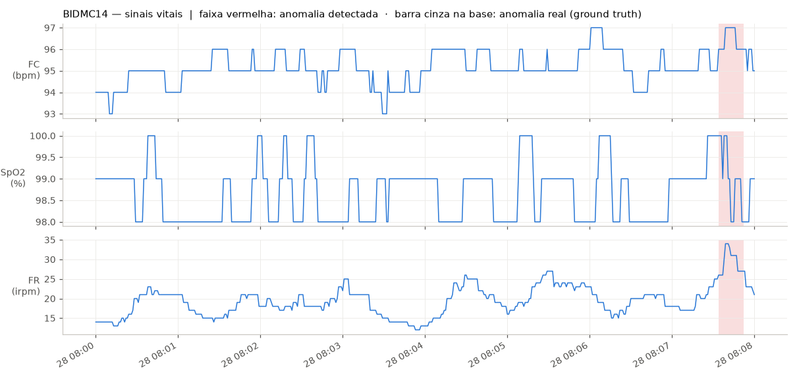

### 6.7 Vídeo

| Vídeo | Resultado |
|---|---|
| Agachamento (P001) | 6 repetições, ROM média 107,6°, ângulo mínimo médio do joelho 51,9°, sem perda de amplitude (−0,65°/rep); **compensação de tronco** aos 9,4 s (56°, limite 45°) |
| Sentar e levantar — CDC (P005) | 2 repetições completas + 1 incompleta (joelho a 116,7°, alvo ≤ 115°); a extrapolação para 30 s não é feita com < 3 repetições |
| Queda simulada (P005) | **Queda detectada** aos 7,3 s (2,4 corpos/s, tronco 75°) → CRÍTICO, sem alerta redundante de "compensação de tronco" |
| Área crítica | Lotação acima do limite (5–6 pessoas, limite 2) |

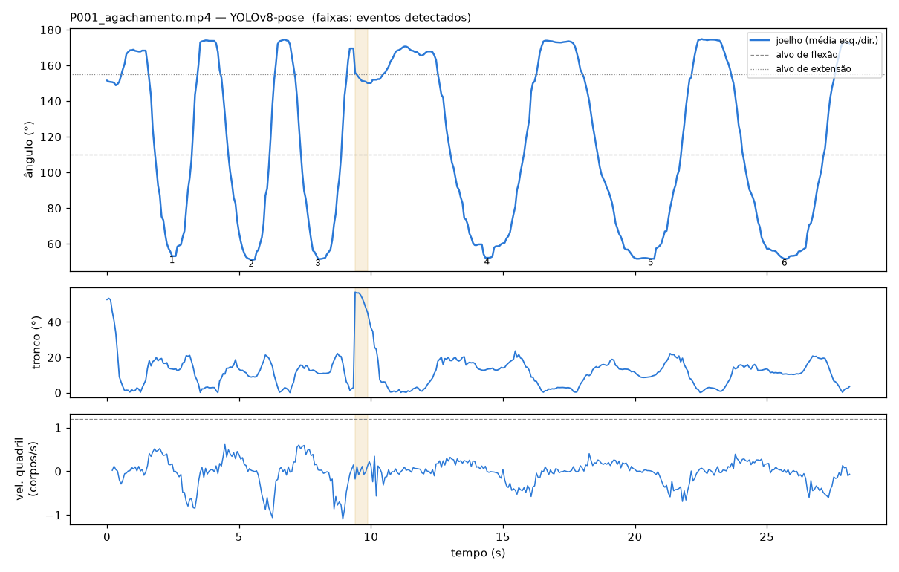

| Agachamento | Queda simulada | Sentar e levantar | Área crítica |
|---|---|---|---|
| 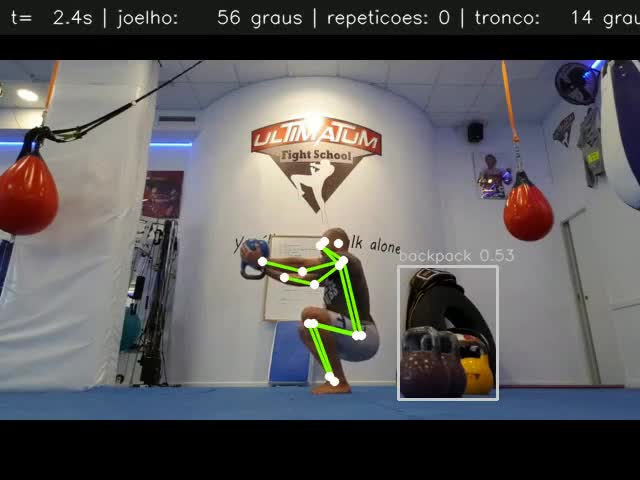 | 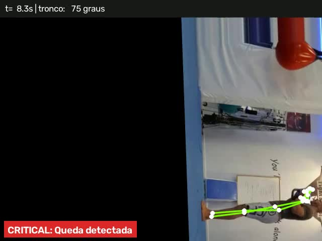 | 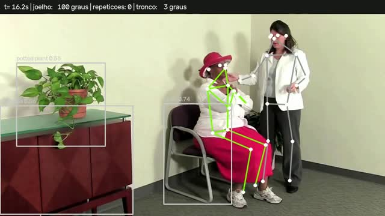 | 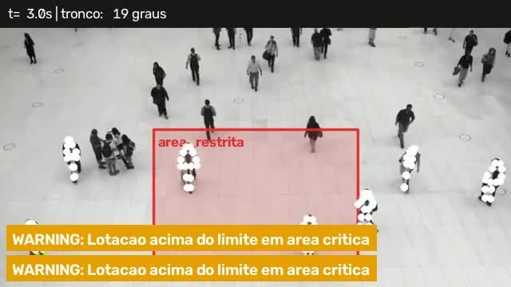 |

### 6.8 Fusão e alertas

40 alertas gerados, **37 despachados** e 3 suprimidos pelo cooldown (15 críticos, 19 de atenção, 3 informativos), sendo **8 de fusão**. O paciente controle ficou em risco **baixo (0,21)** e os quatro pacientes com cenário grave em risco **alto (0,94–1,00)**.

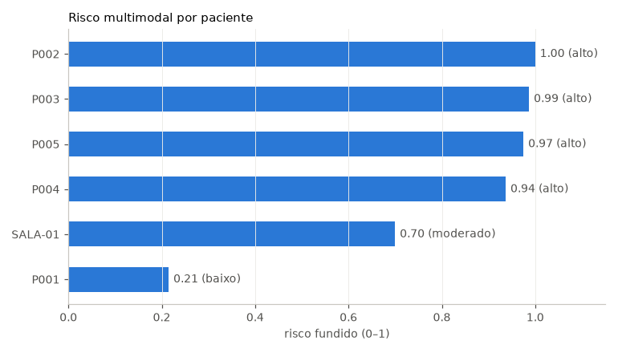

## 7. Exemplos de anomalias detectadas

**P003 — depressão respiratória induzida por opioide (linha do tempo dos alertas):**

| Horário | Modalidade | Alerta |
|---|---|---|
| 21:00 | Prescrição | CRÍTICO — morfina 12 → 60 mg/dia (5×), alta vigilância |
| 21:30 | Prescrição | ATENÇÃO — midazolam: interação com morfina |
| 22:17 | Vitais | CRÍTICO — bradicardia + hipotensão + dessaturação + bradipneia (SpO2 87%, FR 4, NEWS2 8) |
| 22:17 | **Fusão** | **CRÍTICO — suspeita de depressão respiratória induzida por opioide/sedativo** → *suspender/reduzir opioide e sedativo, considerar naloxona* |
| 22:40 | Áudio | CRÍTICO — fala com padrão de dispneia (0,82) corroborada por "falta de ar", "cansaço para respirar" |
| 22:40 | **Fusão** | **CRÍTICO — insuficiência respiratória confirmada por voz e sinais vitais** |

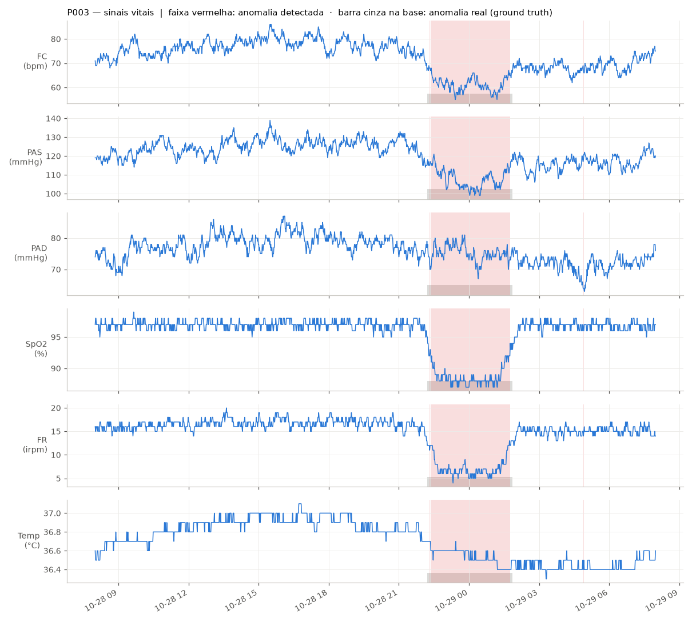

**P004 — suspeita de AVC cardioembólico.** Três episódios de taquicardia paroxística (FC até 169 bpm) e, às 03:10, uma consulta com fala disártrica (0,60) e relato de "fala está enrolada", "formigamento", "visão turva". Nenhum dos dois achados isolados é crítico; juntos disparam **R4 — CRÍTICO, acionar protocolo de AVC**. Esse é o exemplo mais claro do valor da fusão.

**P002 — sepse com *delirium*.** Febre (39,2 °C), taquicardia, taquipneia e hipotensão (PAS 72) a partir das 18:18; agitação noturna sustentada por 169 min a partir de 01:03 → **R3 — CRÍTICO, abrir protocolo de sepse e avaliar CAM-ICU**. Também detectada a duplicidade heparina + enoxaparina.

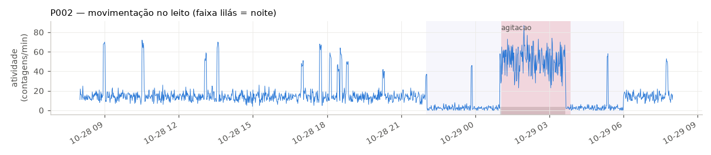

**P005 — queda confirmada por três fontes.** Às 02:59 o vídeo detecta a queda; às 03:00 o sensor do leito registra pico seguido de ausência de sinal; às 03:03 a FC sobe para 104 bpm (dor). **R5** confirma a queda por movimento + vídeo + vitais. Às 03:30 a insulina é triplicada → **R7** pede confirmação com o médico. Antes disso, R6 já indicava risco elevado de queda (repetição incompleta no teste funcional + imobilidade de 5,5 h + fala com fadiga).

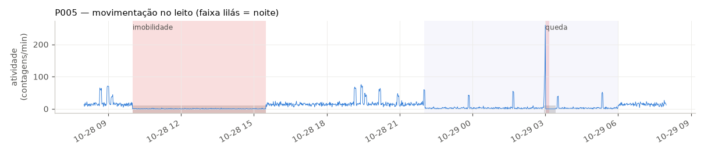

## 8. Limitações e considerações éticas

- **Dados sintéticos.** As métricas medem se o sistema detecta padrões conhecidos; não substituem validação clínica prospectiva. Os limiares de áudio foram calibrados em sinais sintetizados e precisam de recalibração com gravações reais rotuladas por fonoaudiólogos.
- **Biomarcadores vocais aproximados.** Jitter, shimmer e HNR são aproximações em nível de quadro, não as medidas de referência do Praat.
- **Vídeo.** Ângulos 2D dependem do ângulo da câmera (vista frontal subestima a flexão do joelho); a queda foi validada com simulação, não com quedas reais; COCO não tem instrumental cirúrgico.
- **Fusão por regras.** As 7 regras são explicáveis e auditáveis, mas cobrem cenários previstos; um modelo aprendido de fusão exigiria dados reais rotulados.
- **Privacidade (LGPD).** Áudio e vídeo de pacientes são dados sensíveis. Em produção: consentimento, recursos Azure em região brasileira (`brazilsouth`), sem retenção de dados pelo serviço, acesso por identidade gerenciada em vez de chaves, criptografia em repouso e trilha de auditoria (o log JSONL é o ponto de partida).
- **Responsabilidade.** O sistema sugere condutas e prioriza a atenção; a decisão clínica é sempre da equipe.

## 9. Próximos passos

1. Ingestão em streaming real (Azure Event Hubs / IoT Hub a partir do monitor multiparamétrico) com o `StreamingVitalsMonitor` em Azure Functions.
2. Pesos YOLOv8 ajustados para instrumental cirúrgico (m2cai16-tool, Cholec80) e rastreamento multiobjeto (ByteTrack) nas áreas críticas.
3. Recalibrar os biomarcadores vocais com bases rotuladas (ex.: TORGO para disartria, gravações de consultas com consentimento).
4. Fusão aprendida (ex.: gradient boosting sobre os escores e eventos das modalidades) quando houver desfechos clínicos rotulados.
5. Alertas com confirmação de leitura e escalonamento (Azure Communication Services: SMS/voz para o plantonista).

## 10. Reprodutibilidade

```bash
pip install torch torchvision --index-url https://download.pytorch.org/whl/cpu
pip install -r requirements.txt
python main.py demo                       # todos os resultados deste relatório
python main.py physionet --record 14      # seção 6.6
pytest                                    # 28 testes
```

Sementes fixas em todos os geradores e modelos (`random_state=42`). Todos os limiares estão em `config.yaml`.

## 11. Referências

- Cao, Z. et al. *OpenPose: Realtime Multi-Person 2D Pose Estimation using Part Affinity Fields*. IEEE TPAMI, 2019.
- Jocher, G. et al. *Ultralytics YOLOv8*. 2023. https://github.com/ultralytics/ultralytics
- Royal College of Physicians. *National Early Warning Score (NEWS) 2*. 2017.
- Liu, F. T.; Ting, K. M.; Zhou, Z.-H. *Isolation Forest*. IEEE ICDM, 2008.
- Pimentel, M. A. F. et al. *Towards a Robust Estimation of Respiratory Rate from Pulse Oximeters*. IEEE TBME, 2016 (BIDMC dataset).
- Goldberger, A. et al. *PhysioBank, PhysioToolkit, and PhysioNet*. Circulation, 2000.
- de Jong, N. H.; Wempe, T. *Praat script to detect syllable nuclei and measure speech rate automatically*. Behavior Research Methods, 2009.
- Mauch, M.; Dixon, S. *pYIN: A fundamental frequency estimator using probabilistic threshold distributions*. ICASSP, 2014.
- Singer, M. et al. *The Third International Consensus Definitions for Sepsis and Septic Shock (Sepsis-3)*. JAMA, 2016.
- Centers for Disease Control and Prevention. *STEADI — 30-Second Chair Stand Test*.
- ISMP. *List of High-Alert Medications in Acute Care Settings*.
- Microsoft. *Azure AI Speech* e *Azure AI Language (Text Analytics for health)* — documentação oficial.
